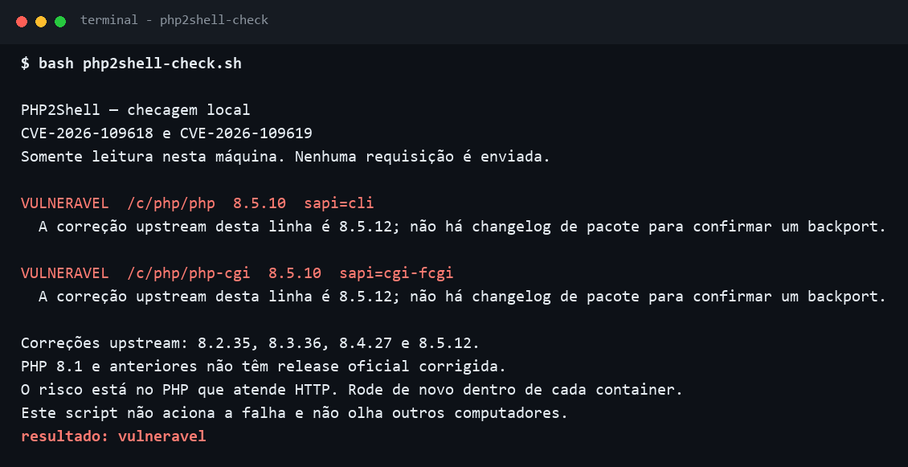
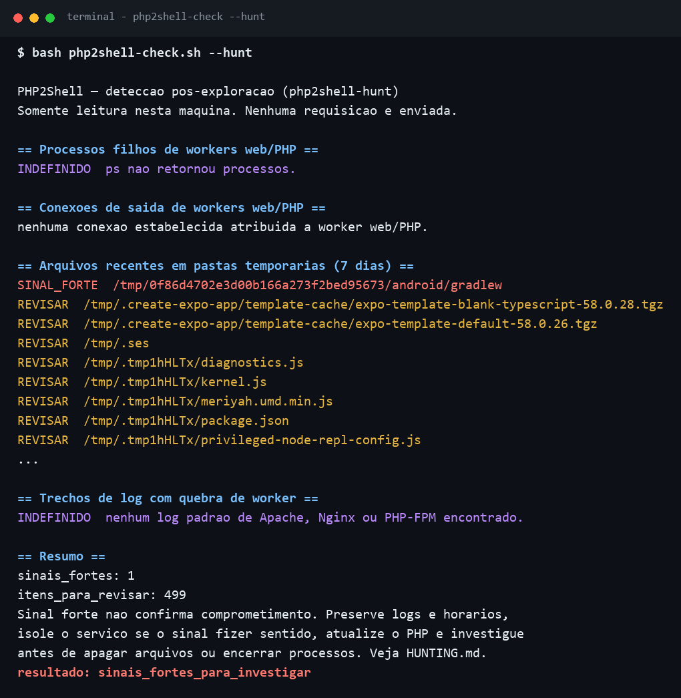
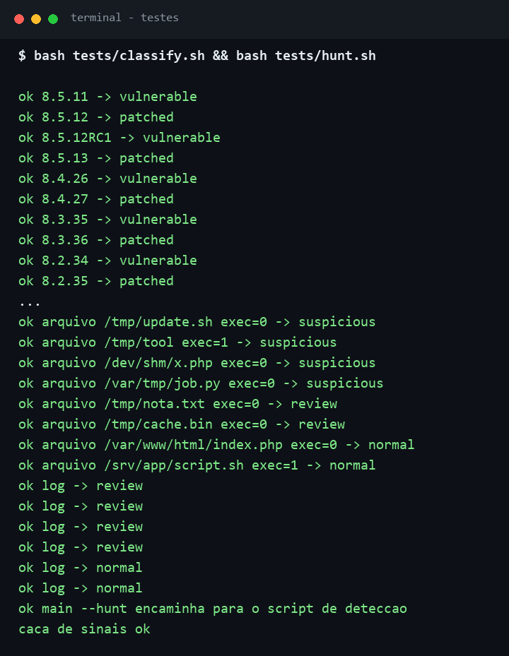

# PHP2Shell check

Script bash para ver, **nesta máquina**, se o PHP instalado está na faixa das falhas
PHP2Shell: [CVE-2026-109618](https://github.com/php/php-src/security/advisories/GHSA-w8hw-w9fx-j79w)
e [CVE-2026-109619](https://github.com/php/php-src/security/advisories/GHSA-6wmf-4rv5-p3rp).

Ele não envia requisição, não recebe um host e não tenta acionar a falha.
Compara a versão do binário com as releases corrigidas e, quando a versão ainda
é antiga, procura as duas CVEs no changelog do pacote da distribuição.

## Como roda

No servidor Linux:

```bash
bash php2shell-check.sh
```

Dentro de um container, rode o script **dentro** do container. O PHP da imagem
não aparece na checagem do host.

## Prints



*Saída real nesta máquina de desenvolvimento: PHP 8.5.10, ainda sem a correção 8.5.12.*

## Detecção pós-exploração

Para procurar sinais que pedem investigação — filho estranho de worker,
executável recente em pasta temporária, quebra de worker no log:

```bash
bash php2shell-check.sh --hunt
```

Sinal não é comprometimento confirmado. O que cada linha significa, a
conferência manual e o que fazer se aparecer sinal forte estão em
[HUNTING.md](HUNTING.md).



*Nesta máquina de desenvolvimento, o `/tmp` tem cache de ferramentas de build — por isso tantos `REVISAR`. Num servidor, a mesma lista costuma ser bem menor. As seções `INDEFINIDO` aparecem aqui porque esta captura não é de um Linux com Apache/PHP-FPM.*

## Como le

| Linha | Significado |
| --- | --- |
| `VULNERAVEL` | Versão na faixa afetada e o changelog não cita as duas correções |
| `OK` | Versão igual ou posterior à correção upstream daquela linha |
| `BACKPORT` | Versão antiga, mas o changelog do pacote cita as duas CVEs |
| `FORA_DA_FAIXA` | Abaixo da série 5.4, onde a faixa publicada começa |
| `INDEFINIDO` | Versão que o aviso de 21 out 2026 não cobre |
| `ERRO` | Havia um arquivo PHP, mas a versão não pôde ser lida |

Código de saída: `1` se houver linha `VULNERAVEL`, `2` se não achou PHP ou a leitura ficou incompleta, `0` se nenhuma versão vulnerável foi confirmada.

`0` não significa “servidor seguro”. Significa que, entre os PHP que o script conseguiu ler, nenhum ficou na faixa dessas duas CVEs sem um indício de correção.

## Versões

Segundo o aviso do PHP e os alertas publicados em 21 out 2026:

| Linha | Corrigida a partir de |
| --- | --- |
| 8.5 | 8.5.12 |
| 8.4 | 8.4.27 |
| 8.3 | 8.3.36 |
| 8.2 | 8.2.35 |
| 8.1 e anteriores, desde a série 5.4 | sem release oficial; algumas distribuições publicam backport |

A correção é atualizar e reiniciar php-fpm, Apache ou o serviço equivalente.
Ajuste de configuração não entra neste script como “corrigido”: o aviso do PHP
trata a atualização como a única correção completa.

## Limites

- PHP compilado à mão, com o patch aplicado em cima de uma versão antiga, continua com o mesmo número. O script não tem como ver isso.
- Um changelog que cita as CVEs é indício do empacotador, não uma auditoria do binário.
- Processo antigo permanece na versão anterior até o reinício. O script marca isso quando consegue ler `/proc/<pid>/exe`.
- Não cobre a CVE-2026-115560, divulgada em 23 out 2026. Até sair correção, o PHP recomenda `session.upload_progress.enabled=0`.

## Teste da matriz

```bash
bash tests/classify.sh
bash tests/hunt.sh
```

Conferir a matriz não lê o PHP da máquina. Só verifica se `8.5.11` continua vulnerável, `8.5.12` corrigido, e os demais cortes publicados. O segundo teste guarda o que a caça considera sinal forte, item de revisão ou linha comum.


